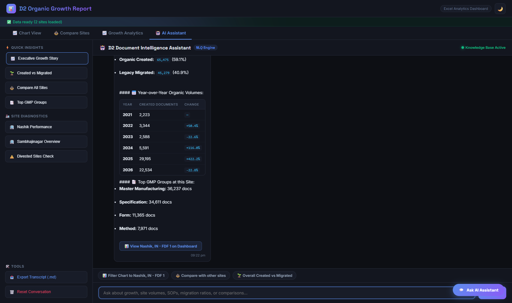
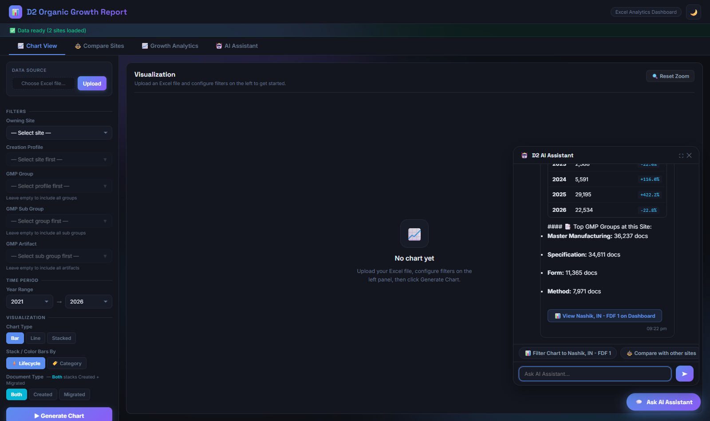
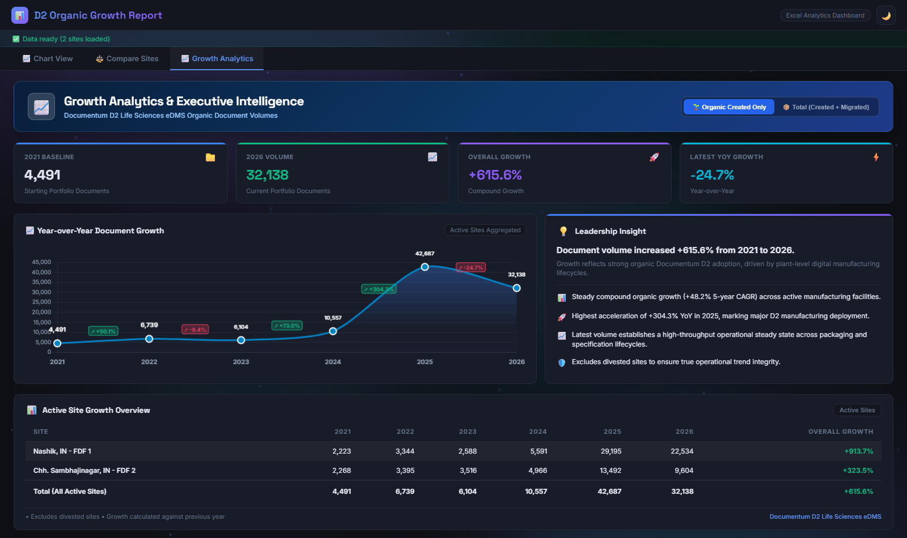
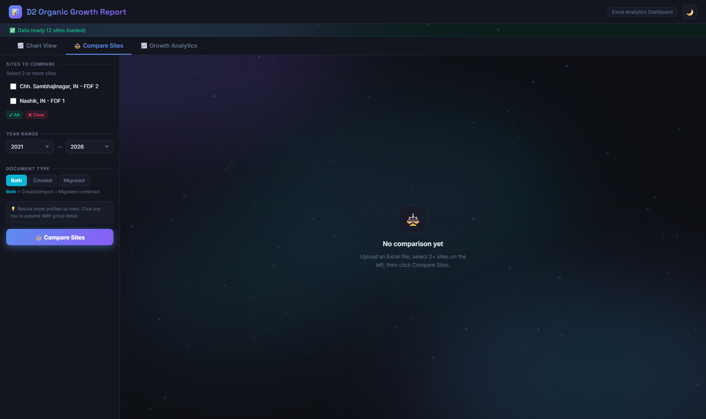

# 🤖 Documentum D2 Life Sciences eDMS — AI Assistant & Growth Analytics

An intelligent, interactive Natural Language Querying (NLQ) assistant and analytics platform for **OpenText Documentum D2 Life Sciences Electronic Document Management Systems (eDMS)**.

Combines multi-site manufacturing document analytics with a conversational domain-aware assistant that answers executive questions, benchmarks plant volume trajectories, and controls dashboard views in real-time.

---

## 📸 Application Screenshots

### 1. 🤖 Dedicated AI Assistant Workspace (NLQ & Prompt Library)
Ask complex questions about 5-year CAGR, site-specific document generation, organic vs. migrated ratios, and top GMP groups.

### 2. 💬 Global Floating AI Assistant Widget
Always-accessible conversational drawer that overlays any chart or analysis view for rapid insights.

### 3. 📈 Executive Growth Analytics (YoY & 5-Year CAGR)
Dynamic leadership dashboard displaying portfolio baseline, multi-year expansion curve, active site matrix, and automated insights.

### 4. 📊 Multi-Filter Granular Document Explorer
Drill into manufacturing sites, creation profiles, and hierarchical GMP groups across operational years (2021–2026).

### 5. ⚖️ Cross-Plant Site Comparison
Benchmark organic document volume velocity across manufacturing facilities (e.g. Nashik vs. Chh. Sambhajinagar).

---

## 🧠 Conversational Intelligence Capabilities

The built-in assistant understands real-world Documentum D2 Life Sciences terminology and provides instant data-backed responses:

| Category | Example Natural Language Questions | Bot Response Behavior |
|---|---|---|
| **Executive Growth** | *\"What is the executive growth story?\"*, *\"What is the portfolio CAGR?\"* | Calculates baseline (,491$), current volume (,138$), $+615.6\%$ expansion, $+48.2\%$ CAGR, and triggers a tab switch to Growth Analytics. |
| **Site Deep Dives** | *\"Tell me about Nashik\"*, *\"What is Sambhajinagar volume?\"* | Summarizes total volume, Created vs. Migrated breakdown, yearly YoY changes, top GMP groups, and auto-filters the chart view. |
| **Organic vs Migrated** | *\"What is the Created vs Migrated ratio?\"*, *\"Show organic adoption\"* | Computes total organic creation (,214$ docs, .0\%$) vs. legacy migrated imports (,489$ docs, .0\%$). |
| **GMP Groups & Artifacts** | *\"What are the top GMP groups?\"*, *\"Show SOP volume\"* | Produces markdown ranking table for Master Manufacturing, Specifications, Forms, and Method lifecycles. |
| **Plant Comparisons** | *\"Compare all operating sites\"*, *\"Nashik vs Sambhajinagar\"* | Compares multi-year totals and CAGR across active facilities side-by-side. |
| **Divestment Integrity** | *\"Are there any divested sites?\"* | Audits portfolio to ensure inactive/divested plants are excluded from baseline calculations. |

---

## 📐 Mathematical Growth Mechanics & Methodology

Implemented in [`GrowthAnalyticsService.java`](src/main/java/com/example/excelviz/service/GrowthAnalyticsService.java):

* **Baseline Volume ($):** Total organic documents created in starting year ( = 4,491$).
* **Current Volume ($):** Total organic documents created in final year ( = 32,138$).
* **Overall Growth \%:** $\left(\frac{V_n - V_0}{V_0}\right) \times 100 = \mathbf{+615.6\%}$.
* **5-Year Compound Annual Growth Rate (CAGR):**
  \text{CAGR} = \left[\left(\frac{32,138}{4,491}\right)^{\frac{1}{5}} - 1\right] \times 100 = \mathbf{+48.2\%}
* **YoY Acceleration:** Peak acceleration recorded in **2025 at $+304.3\%$ YoY** (,557 \rightarrow 42,687$), marking primary enterprise D2 plant rollout.

---

## 🚀 Getting Started

### Prerequisites
* Java JDK 17+
* Maven 3.8+ (or included ./mvnw)

### Running Locally
`ash
# Clone the repository
git clone https://github.com/manojvenaram/D2_organic_growth_report_chatbot.git
cd D2_organic_growth_report_chatbot

# Run test suite
./mvnw test

# Start the application
./mvnw spring-boot:run
`

Once started, open your browser at:
`
http://localhost:8082
`

1. Upload your Documentum D2 Excel metadata file.
2. Click the **🤖 AI Assistant** tab to ask questions or use the quick suggestion chips.
3. Use the floating chat button on the bottom-right of any screen to interact on the fly!

---

## 🛡️ Confidentiality Note
In compliance with corporate data security standards, no proprietary raw Excel spreadsheets are stored in this repository. All data is processed dynamically in-memory via Apache POI.
