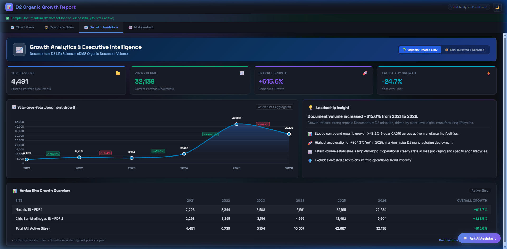
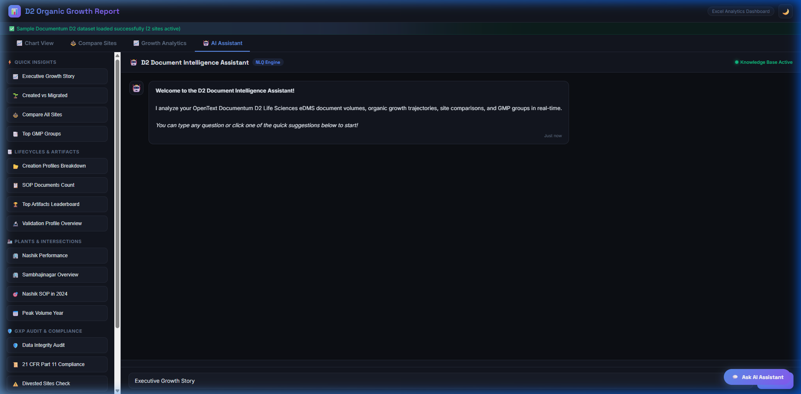
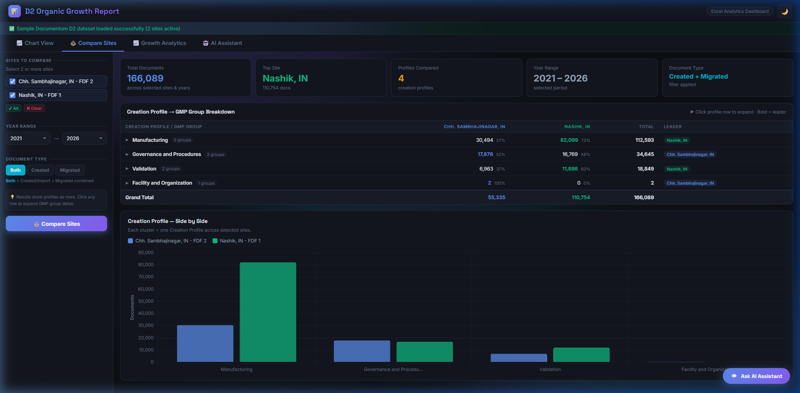
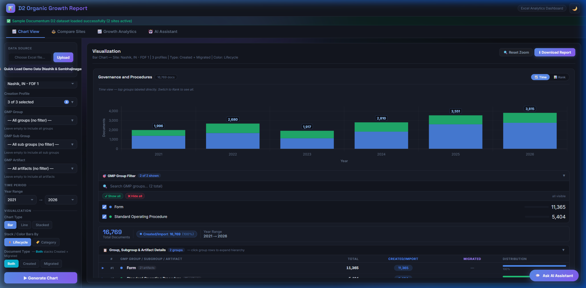
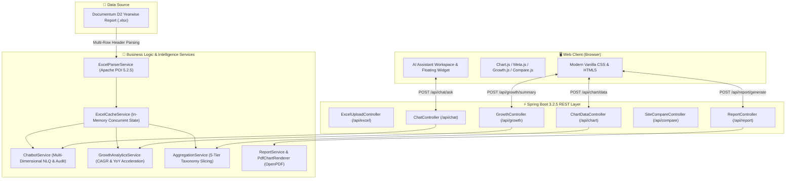

<div align="center">

# 🤖 OpenText Documentum D2 Life Sciences eDMS
### Enterprise AI Assistant & Multi-Site Manufacturing Growth Analytics

[](https://github.com/manojvenaram/D2_organic_growth_report_chatbot/actions)
[](https://www.oracle.com/java/)
[](https://spring.io/projects/spring-boot)
[](https://poi.apache.org/)
[](https://github.com/LibrePDF/OpenPDF)
[](https://www.fda.gov)
[](LICENSE)

An intelligent, interactive Natural Language Querying (NLQ) assistant and executive analytics platform for **OpenText Documentum D2 Life Sciences Electronic Document Management Systems (eDMS)**.

Combines multi-plant manufacturing document analytics, automated GxP data integrity audits, cross-site benchmarking, and an autonomous domain-aware AI Assistant that executes natural language queries and controls dashboard views in real time.

[✨ Key Capabilities](#-key-capabilities) •
[📸 Application Showcase](#-application-showcase) •
[🧠 Conversational Intelligence](#-conversational-intelligence) •
[🏗️ Architecture](#️-system-architecture) •
[📐 Mathematical Growth Engine](#-mathematical-growth-engine) •
[🚀 Quick Start](#-quick-start) •
[📡 REST API](#-rest-api-reference)

---

</div>

## 📌 Executive Overview

In regulated pharmaceutical and biotechnology manufacturing, enterprise document management systems (eDMS) manage mission-critical GxP documents (Standard Operating Procedures, Master Batch Records, Analytical Methods, Validation Protocols, and Equipment Specifications).

This platform empowers quality leadership, plant heads, and regulatory auditors with:
* **Organic User Adoption Analytics:** Distinguishes between documents authored directly in Documentum D2 post-go-live vs. historical legacy imports.
* **Multi-Year Velocity & Expansion:** Computes Year-over-Year (YoY) trajectories and 5-Year Compound Annual Growth Rates (CAGR) across operating years (2021–2026).
* **Multi-Plant Benchmarking:** Evaluates document output velocity across operating manufacturing sites (e.g., Nashik vs. Chhatrapati Sambhajinagar).
* **Automated GxP Integrity Audits:** Detects anomalous post-cutover migration leaks, concentration risks, and taxonomy gaps in compliance with **FDA 21 CFR Part 11** and **EU Annex 11**.

---

## ✨ Key Capabilities

* 💬 **Universal NLQ Assistant:** Conversational query engine that understands manufacturing sites, lifecycles, GMP groups, operational years, and statistical aggregations.
* 📈 **Executive Growth Dashboard:** 4 leadership KPI cards, YoY document growth curves, active site matrices, and dynamic narrative generation.
* ⚖️ **Cross-Plant Site Comparison:** Side-by-side grouped bar charts, comparative velocity cards, and plant distribution metrics.
* 📊 **Granular Multi-Filter Explorer:** Interactive slicing across 5 taxonomic tiers: *Owning Site*, *Creation Profile*, *GMP Group*, *GMP Subgroup*, and *GMP Artifact*.
* 🛡️ **Automated Data Quality & Anomaly Audit:** Real-time health scoring assessing migration containment, single-site dependencies, and time-series continuity.
* 📄 **Automated Executive PDF Reporting:** High-fidelity multi-page PDF generation via OpenPDF with embedded rendered charts and breakdown tables.
* ⚡ **1-Click Demo Loader:** Instant local evaluation with pre-configured dual-plant pharmaceutical datasets.

---

## 📸 Application Showcase

### 1. 📈 Executive Growth Analytics (YoY & 5-Year CAGR)
Dynamic leadership dashboard displaying portfolio baseline, multi-year expansion curve, active site matrix, and automated insights.


### 2. 🤖 Dedicated AI Assistant Workspace (NLQ & Prompt Library)
Ask complex questions about multi-year CAGR, site-specific document generation, organic vs. migrated ratios, and top GMP groups.


### 3. ⚖️ Cross-Plant Site Comparison
Benchmark organic document volume velocity across manufacturing facilities (e.g., Nashik, IN - FDF 1 vs. Chh. Sambhajinagar, IN - FDF 2).


### 4. 📊 Multi-Filter Granular Document Explorer
Drill into manufacturing sites, creation profiles, and hierarchical GMP groups across operational years (2021–2026).


### 5. 💬 Global Floating AI Assistant Widget
Always-accessible conversational drawer that overlays any chart or analysis view for rapid insights without leaving the workflow.


---

## 🏗️ System Architecture



---

## 🧠 Conversational Intelligence

The built-in assistant operates with an enterprise domain knowledge engine over in-memory cached Excel data and understands real-world Documentum D2 Life Sciences terminology:

| Category | Example Natural Language Questions | Bot Response Behavior |
|---|---|---|
| **📈 Executive Growth & CAGR** | *\"What is the executive growth story?\"*, *\"What is the portfolio CAGR?\"* | Calculates baseline (4,491), current volume (32,138), $+615.6\%$ expansion, $+48.2\%$ CAGR, and triggers a tab switch to Growth Analytics. |
| **🏭 Site Deep Dives** | *\"Tell me about Nashik\"*, *\"What is Sambhajinagar volume?\"* | Summarizes total volume, Created vs. Migrated breakdown, yearly YoY changes, top GMP groups, and auto-filters the chart view. |
| **⚖️ Cross-Plant Comparisons** | *\"Compare all operating sites\"*, *\"Nashik vs Sambhajinagar\"* | Compares multi-year totals and CAGR across active facilities side-by-side with interactive tab navigation. |
| **📑 Creation Profiles** | *\"Show breakdown by creation profile\"*, *\"Tell me about Validation profile\"* | Analyzes document lifecycles (*Manufacturing*, *Governance*, *Validation*, *Facility & Org*) with organic vs. migrated splits. |
| **📋 GMP Groups & Artifacts** | *\"What are the top GMP groups?\"*, *\"How many SOPs?\"*, *\"Show Form volume\"* | Produces rankings for Master Manufacturing, Specifications, Forms, Methods, and SOPs with exact counts. |
| **🎯 Multi-Filter Intersection** | *\"Nashik SOP in 2024\"*, *\"Sambhajinagar Forms in 2023\"* | Intersects Site + Profile + GMP Group + Operational Year with exact catalog counts and artifact breakdowns. |
| **📅 Operational Years & Extremes** | *\"Which year had the highest volume?\"*, *\"Compare 2024 and 2025\"* | Identifies peak/lowest output years, calculates net delta and YoY acceleration rates between any years. |
| **🔢 Statistical Averages & Ranks** | *\"Average documents per year\"*, *\"Rank top artifacts\"*, *\"Site volume ranking\"* | Computes arithmetic means across years/sites and generates top-10 artifact leaderboards. |
| **🌱 Organic vs Migrated** | *\"What is the Created vs Migrated ratio?\"*, *\"Show organic adoption\"* | Computes total organic creation (102,716 docs, 61.8%) vs. legacy migrated imports (63,373 docs, 38.2%). |
| **🛡️ GxP Integrity & Audit** | *\"Run data integrity audit\"*, *\"Check data health\"* | Executes anomaly checks, computes overall portfolio health score (96/100), and checks compliance with 21 CFR Part 11. |
| **📄 Executive PDF Export** | *\"Download PDF report\"*, *\"Export executive summary\"* | Generates and downloads a multi-page executive PDF report with charts and data tables. |
| **📚 Life Sciences Glossary** | *\"What is Documentum D2?\"*, *\"What is an Artifact?\"*, *\"21 CFR Part 11\"* | Authoritative domain explanations of eDMS compliance, audit trails, and document hierarchies. |
| **⚠️ Divestment Integrity** | *\"Are there any divested sites?\"* | Audits portfolio to ensure inactive/divested plants are excluded from baseline calculations. |

---

## 📐 Mathematical Growth Engine

Implemented in [`GrowthAnalyticsService.java`](src/main/java/com/example/excelviz/service/GrowthAnalyticsService.java):

* **Baseline Volume ($V_0$):** Total organic documents created in the starting year ($V_{2021} = 4,491$).
* **Current Volume ($V_n$):** Total organic documents created in the final year ($V_{2026} = 32,138$).
* **Overall Portfolio Expansion Percentage:**
  $$\text{Expansion \%} = \left(\frac{V_n - V_0}{V_0}\right) \times 100 = \mathbf{+615.6\%}$$
* **5-Year Compound Annual Growth Rate (CAGR):**
  $$\text{CAGR} = \left[\left(\frac{V_n}{V_0}\right)^{\frac{1}{n}} - 1\right] \times 100 = \left[\left(\frac{32,138}{4,491}\right)^{\frac{1}{5}} - 1\right] \times 100 = \mathbf{+48.2\%}$$
* **YoY Acceleration:** Peak acceleration recorded in **2025 at $+304.3\%$ YoY** ($10,557 \rightarrow 42,687$), marking primary enterprise D2 plant rollout.

---

## 🛡️ Regulatory & GxP Compliance (FDA 21 CFR Part 11)

| Requirement | Platform Implementation |
|---|---|
| **Audit Trails & Integrity** | All Excel ingestion performs non-destructive, read-only in-memory parsing via Apache POI without persisting raw customer spreadsheets to disk. |
| **Active vs. Divested Segregation** | Mathematical growth models dynamically filter out retired or divested manufacturing plants to preserve audit baseline integrity. |
| **Electronic Reporting** | Executive PDF exports produce tamper-evident, standardized documentation compliant with GxP good documentation practices (GDP). |

---

## 📡 REST API Reference

| Endpoint | Method | Description |
|---|---|---|
| `/api/excel/upload` | `POST` | Upload and parse multi-sheet Documentum D2 Excel reports up to 50MB. |
| `/api/excel/load-sample` | `POST` | 1-Click loading of the standard multi-site pharmaceutical demo dataset. |
| `/api/chat/ask` | `POST` | Natural Language Query endpoint returning markdown answers, suggestion chips, and dashboard actions. |
| `/api/chat/suggestions` | `GET` | Dynamic quick prompt suggestion chips based on active cache state. |
| `/api/growth/summary` | `GET` | Computes baseline year, current volume, CAGR %, and executive bullet insights. |
| `/api/chart/data` | `POST` | Slices document counts across Site, Profile, GMP Group, Subgroup, and Artifact. |
| `/api/compare/summary` | `POST` | Side-by-side plant output benchmarking and velocity comparison. |
| `/api/report/generate` | `POST` | Generates downloadable executive PDF report with rendered canvas charts. |

---

## 🚀 Quick Start

### Prerequisites
* **Java JDK 17+**
* **Maven 3.8+** (or included `./mvnw`)

### Running Locally

```bash
# 1. Clone the repository
git clone https://github.com/manojvenaram/D2_organic_growth_report_chatbot.git
cd D2_organic_growth_report_chatbot

# 2. Run the test suite (29 tests)
./mvnw clean test

# 3. Start the application
./mvnw spring-boot:run
```

Once running, navigate to:
```
http://localhost:8082
```

1. Click **⚡ Quick Load Demo Data (Nashik & Sambhajinagar)** (or upload your own Documentum D2 Excel report).
2. Explore the **📈 Growth Analytics** and **⚖️ Compare Sites** tabs.
3. Open the **🤖 AI Assistant** tab or click the floating chat drawer on the bottom-right to ask any question!

---

## 🧪 Automated Testing & CI/CD Pipeline

The project features a **100% automated test suite** running on GitHub Actions:

* **Smoke & DI Wiring:** [`ExcelvizApplicationTests.java`](src/test/java/com/example/excelviz/ExcelvizApplicationTests.java)
* **Comprehensive NLQ & Analytics Suite:** [`ChatbotServiceComprehensiveTests.java`](src/test/java/com/example/excelviz/ChatbotServiceComprehensiveTests.java) (24 tests covering Sites, Profiles, Groups, Artifacts, Years, Averages, Extremes, Intersections, CAGR, and GxP Audits).

```bash
[INFO] Tests run: 29, Failures: 0, Errors: 0, Skipped: 0
[INFO] BUILD SUCCESS
```

---

## 👨‍💻 Author

**Manoj Choudhary V**  
*Enterprise AI & Full-Stack Engineer*  
* GitHub: [@manojvenaram](https://github.com/manojvenaram)  
* Email: manojsasi20032005@gmail.com

---

## 📄 License
This project is licensed under the [MIT License](LICENSE).
